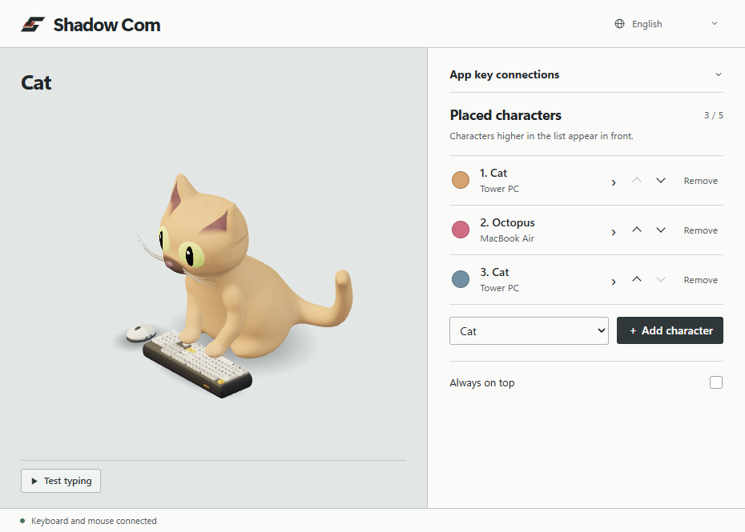
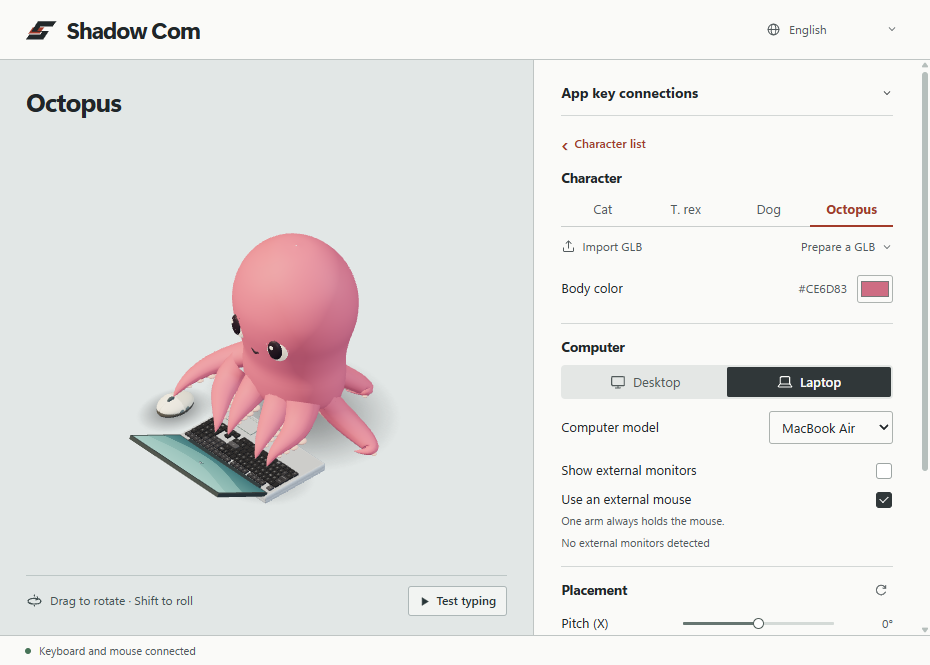

# Shadow Com

[한국어](README.md) · **English** · [日本語](README.ja.md)

A 3D desktop pet that reacts to your keyboard and mouse. Choose a cat, dog, T. rex or octopus, and place up to five on your desktop.

[Getting started](#getting-started) · [Show keys from other apps](#show-keys-from-other-apps) · [Import your own GLB character](docs/custom-glb.en.md)

## Download

<!-- latest-release:start -->
**Latest version [v1.2.7](https://github.com/despild/shadow-com-releases/releases/tag/v1.2.7)**

| Platform | Download | Installation |
| --- | --- | --- |
| Windows | [Shadow-Com-Setup-1.2.7-x64.exe](https://github.com/despild/shadow-com-releases/releases/download/v1.2.7/Shadow-Com-Setup-1.2.7-x64.exe) | Run the installer. |
| macOS 13 or later · Apple Silicon | [Shadow-Com-1.2.7-mac-arm64.zip](https://github.com/despild/shadow-com-releases/releases/download/v1.2.7/Shadow-Com-1.2.7-mac-arm64.zip) | Unzip and move the app to Applications. |
| macOS 13 or later · Intel | [Shadow-Com-1.2.7-mac-x64.zip](https://github.com/despild/shadow-com-releases/releases/download/v1.2.7/Shadow-Com-1.2.7-mac-x64.zip) | Unzip and move the app to Applications. |
| Ubuntu | [shadow-com_1.2.7_amd64.deb](https://github.com/despild/shadow-com-releases/releases/download/v1.2.7/shadow-com_1.2.7_amd64.deb) | Install the DEB package. |

### What’s new

- On Ubuntu, select **App key connections → Enable Ubuntu app accessibility** once. From your next login, you can open Chrome normally.
- If keys still do not appear in a Chrome window you already had open, visit `chrome://accessibility/` in a new tab and enable **Native accessibility API support** and **Web accessibility**. You can close the tab and keep working in your document.
- On Ubuntu X11, address-bar and document key mapping and password-field protection were verified in a fresh login session and in an already running browser.

[All releases](https://github.com/despild/shadow-com-releases/releases)
<!-- latest-release:end -->

Each release lists SHA-256 checksums for the installers. The Windows installer is unsigned. The Mac app is ad-hoc signed and has not been notarized by Apple.

## Getting started

1. Open **Shadow Com** from your apps after installation. The pet and its settings appear on first launch. Click **Test typing** to see the pet use its keyboard in the preview.
2. Under **Placed characters**, pick a species and click **Add character**. You can add the same species more than once. Use the arrows to move a pet higher in the list so it appears in front when pets overlap. **Remove** applies to that pet only.

3. Click a pet's name to change its **Body color**, **Computer** and **Computer model**. The octopus below uses a MacBook Air. Each pet has its own color and equipment.
4. Drag the preview to rotate it, or hold **Shift** and drag to tilt. Under **Placement**, the X, Y and Z sliders adjust the angle, and **Widget size** changes its size. Use **Display → Flash pressed key** to toggle the key label.
5. Close settings and drag the pet to its spot on the desktop. Click the pet for a reaction. To return to settings, hover over the widget and click its settings button, or choose **Widget settings** in the tray menu.

To use a model you made, click **Import GLB** in that pet's editor. The [custom GLB guide](docs/custom-glb.en.md) covers orientation, Blender export and animation names for typing and sleep.

## Show keys from other apps

| Where you type | How to connect |
| --- | --- |
| macOS | Click **Allow Input Monitoring…** at the bottom of widget settings. If prompted, allow Shadow Com under **System Settings → Privacy & Security → Input Monitoring**. |
| Sublime Text on Windows or Ubuntu | Choose **App key connections → Connect Sublime Text keys**, then type in a regular document. If asked for a folder, open **Preferences → Browse Packages** in Sublime Text and select the `User` folder inside. |
| Bash on Ubuntu | Choose **App key connections → Connect new Bash terminals**, then open a new terminal. For an existing Bash session, run `source /usr/share/shadow-com/bash/prompt.bash`. |
| Chrome on Ubuntu | Choose **App key connections → Enable Ubuntu app accessibility** once. If keys are missing in an already open browser, open `chrome://accessibility/` in a new tab, enable **Native accessibility API support** and **Web accessibility**, then close the tab. On subsequent logins, open Chrome as usual. |

On Ubuntu X11, the widget can show individual keys in recognized editing fields. On native Wayland, it can show a character entered in Chrome's address bar and react to editing-cursor movement in web documents. When a password field is detected, the built-in pets close and cover their eyes, stop typing and hide the key label.
