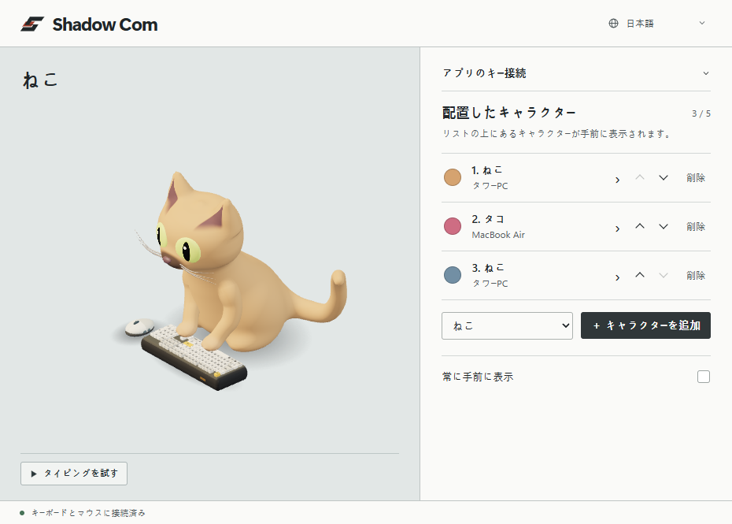
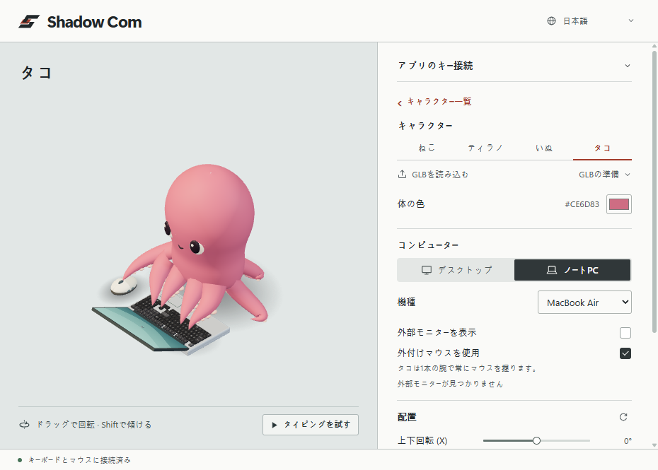

# Shadow Com

[한국어](README.md) · [English](README.en.md) · **日本語**

キーボードとマウスの操作に反応する3Dデスクトップペットです。ねこ、いぬ、ティラノ、タコから選び、デスクトップに最大5匹まで配置できます。

[はじめに](#はじめに) · [ほかのアプリで押したキーを表示する](#ほかのアプリで押したキーを表示する) · [自作のGLBキャラクターを使う](docs/custom-glb.ja.md)

## ダウンロード

<!-- latest-release:start -->
[最新版をダウンロード](https://github.com/despild/shadow-com-releases/releases/latest)
<!-- latest-release:end -->

各リリースにはインストーラーごとのSHA-256が記載されています。Windows版のインストーラーは未署名です。Mac版はアドホック署名されており、Appleの公証は受けていません。

## はじめに

1. インストール後、アプリ一覧から **Shadow Com** を開きます。初回はペットと設定画面が一緒に開きます。**タイピングを試す** を押すと、プレビューでペットがキーを打つ様子を確認できます。
2. **配置したキャラクター** で種類を選び、**キャラクターを追加** を押します。同じ種類を複数追加することもできます。ペットが重なるときは、手前に置きたいキャラクターを矢印でリストの上に移動します。**削除** はその1匹にだけ適用されます。

3. キャラクターの名前を押すと、そのペットの **体の色**、**コンピューター**、**機種** を変更できます。下の例ではタコにMacBook Airを選んでいます。色と機器は1匹ずつ設定できます。
4. プレビューをドラッグして回転させ、**Shift** を押しながらドラッグして傾きを調整します。**配置** ではX・Y・Z軸の回転とウィジェットの幅を調整できます。キーの表示は **表示 → 押したキーを一時表示** で切り替えます。
5. 設定を閉じ、デスクトップのペットを好きな位置にドラッグします。ペットをクリックすると反応します。設定を開き直すには、ウィジェットにポインターを合わせて設定ボタンを押すか、トレイのメニューから **ウィジェット設定** を選びます。

自作モデルは、ペットの編集画面で **GLBを読み込む** を押して取り込みます。モデルの向き、Blenderからの書き出し、タイピングや睡眠のアニメーション名は[カスタムGLB設定ガイド](docs/custom-glb.ja.md)で確認できます。

## ほかのアプリで押したキーを表示する

| 入力する環境 | 接続方法 |
| --- | --- |
| macOS | ウィジェット設定の下部で **入力監視を許可…** を押します。必要に応じて **システム設定 → プライバシーとセキュリティ → 入力監視** でShadow Comを許可してください。 |
| Windows・UbuntuのSublime Text | **アプリのキー接続 → Sublime Text のキーを接続** を押し、通常の文書に入力します。フォルダーを求められたら、Sublime Textの **Preferences → Browse Packages** で開いたフォルダー内の `User` を選びます。 |
| UbuntuのBash | **アプリのキー接続 → 新しい Bash 端末のキーを接続** を押して、新しい端末を開きます。開いているBashでは `source /usr/share/shadow-com/bash/prompt.bash` を実行します。 |
| UbuntuのChrome | **アプリのキー接続 → Ubuntu のアプリのアクセシビリティを有効にする** を一度押します。起動中のChromeでキーが表示されない場合は、新しいタブで `chrome://accessibility/` を開き、**Native accessibility API support** と **Web accessibility** をオンにしてそのタブを閉じます。次回のログインからは普段どおりChromeを開けます。 |

UbuntuのX11では、編集欄として認識できた場所で押したキーを表示します。ネイティブWaylandでは、Chromeのアドレスバーに入力した1文字を表示でき、ウェブ文書では編集カーソルの移動に合わせてペットが反応します。パスワード欄を検出すると、標準のキャラクターは目を閉じて手で覆い、タイピングとキー表示を止めます。
