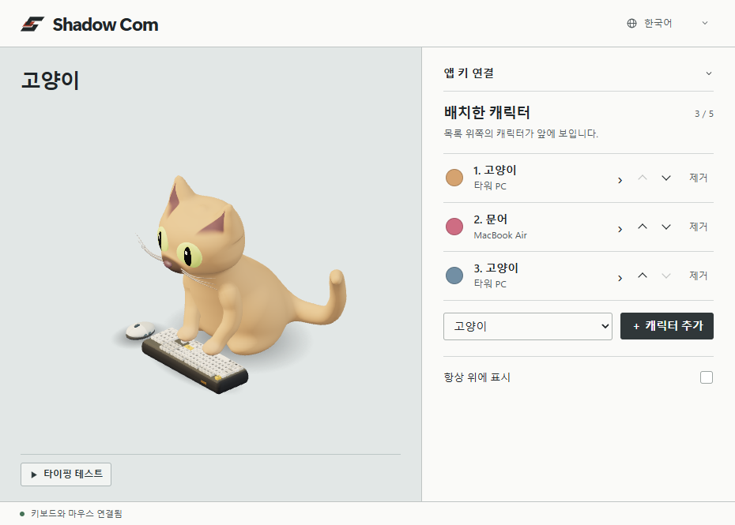
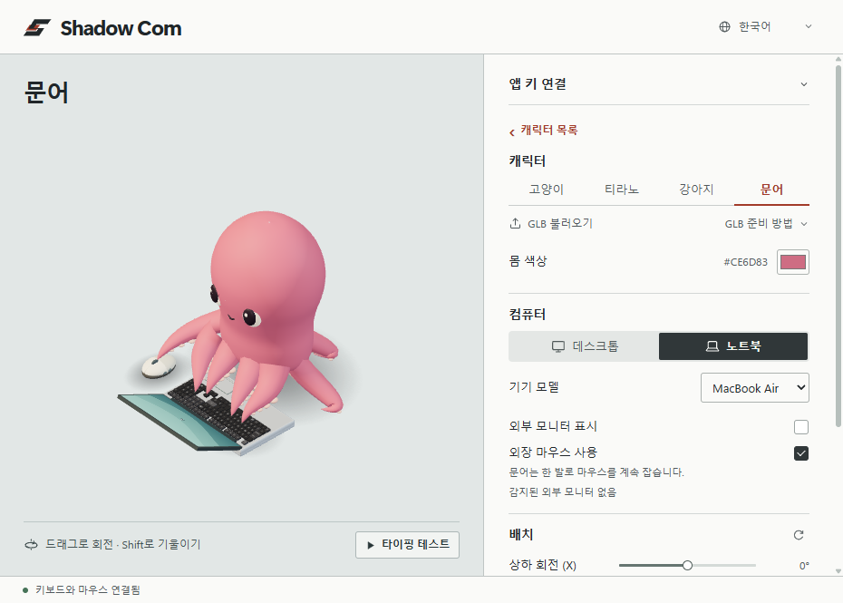

# Shadow Com

**한국어** · [English](README.en.md) · [日本語](README.ja.md)

키보드와 마우스에 반응하는 3D 데스크톱 펫입니다. 고양이, 강아지, 티라노, 문어를 최대 다섯 마리까지 배치할 수 있습니다.

[처음 사용하기](#처음-사용하기) · [다른 앱에서 키 표시하기](#다른-앱에서-키-표시하기) · [내 GLB 캐릭터 적용하기](docs/custom-glb.ko.md)

## 다운로드

<!-- latest-release:start -->
**최신 버전 [v1.2.7](https://github.com/despild/shadow-com-releases/releases/tag/v1.2.7)**

| 운영체제 | 설치 파일 | 설치 방법 |
| --- | --- | --- |
| Windows | [Shadow-Com-Setup-1.2.7-x64.exe](https://github.com/despild/shadow-com-releases/releases/download/v1.2.7/Shadow-Com-Setup-1.2.7-x64.exe) | 설치 프로그램을 실행하세요. |
| macOS 13 이상 · Apple Silicon | [Shadow-Com-1.2.7-mac-arm64.zip](https://github.com/despild/shadow-com-releases/releases/download/v1.2.7/Shadow-Com-1.2.7-mac-arm64.zip) | ZIP을 풀고 앱을 응용 프로그램 폴더로 옮기세요. |
| macOS 13 이상 · Intel | [Shadow-Com-1.2.7-mac-x64.zip](https://github.com/despild/shadow-com-releases/releases/download/v1.2.7/Shadow-Com-1.2.7-mac-x64.zip) | ZIP을 풀고 앱을 응용 프로그램 폴더로 옮기세요. |
| Ubuntu | [shadow-com_1.2.7_amd64.deb](https://github.com/despild/shadow-com-releases/releases/download/v1.2.7/shadow-com_1.2.7_amd64.deb) | DEB 패키지를 설치하세요. |

### 이번 버전의 변경 사항

- Ubuntu에서는 위젯 설정에서 **앱 키 연결 → Ubuntu 앱 접근성 켜기**를 한 번 누르면 다음 로그인부터 평소처럼 Chrome을 실행할 수 있습니다. 접근성 탭을 매번 열 필요가 없습니다.
- 작업 중이던 Chrome에서 아직 키가 보이지 않을 때만 새 탭에 `chrome://accessibility/`를 열어 **Native accessibility API support**와 **Web accessibility**를 켜세요. 설정 탭을 닫고 원래 문서에서 계속 입력할 수 있습니다.
- Ubuntu X11의 새 로그인 세션과 실행 중인 브라우저에서 주소창과 문서 편집 영역의 키 매핑, 비밀번호 입력 보호를 확인했습니다.

[모든 릴리스 보기](https://github.com/despild/shadow-com-releases/releases)
<!-- latest-release:end -->

각 릴리스에는 설치 파일별 SHA-256이 있습니다. Windows 설치 프로그램은 코드 서명이 없으며, Mac 앱은 임시 서명되었고 Apple 공증을 받지 않았습니다.

## 처음 사용하기

1. 설치 후 앱 목록에서 **Shadow Com**을 여세요. 처음 실행하면 캐릭터와 설정 창이 함께 열립니다. **타이핑 테스트**를 누르면 미리보기에서 손발이 움직입니다.
2. **배치한 캐릭터**에서 종류를 고르고 **캐릭터 추가**를 누르세요. 같은 종류도 여러 마리 추가할 수 있습니다. 겹쳤을 때 앞에 보일 캐릭터는 화살표로 목록 위쪽으로 옮기세요. **제거**는 해당 캐릭터 한 마리에만 적용됩니다.

3. 목록에서 캐릭터 이름을 눌러 **몸 색상**, **컴퓨터**, **기기 모델**을 바꾸세요. 아래 화면의 문어는 MacBook Air를 사용합니다. 다른 캐릭터는 각자 고른 색과 기기를 사용합니다.
4. 미리보기를 드래그하면 시점이 회전하고, **Shift**를 누른 채 드래그하면 좌우로 기울어집니다. **배치**에서 X·Y·Z 회전과 위젯 크기를 조절할 수 있습니다. **표시 → 눌린 키 잠시 표시**에서 글자 표시를 켜거나 끄세요.
5. 설정 창을 닫고 바탕화면의 캐릭터를 원하는 위치로 드래그하세요. 캐릭터를 클릭하면 반응합니다. 설정을 다시 열려면 위젯에 마우스를 올려 설정 버튼을 누르거나 트레이 메뉴에서 **위젯 설정**을 선택하세요.

직접 만든 모델은 캐릭터 편집 화면의 **GLB 불러오기**로 적용합니다. 모델 방향, Blender 내보내기, 타이핑·수면 애니메이션 이름은 [커스텀 GLB 설정 가이드](docs/custom-glb.ko.md)에 정리했습니다.

## 다른 앱에서 키 표시하기

| 사용 환경 | 설정 방법 |
| --- | --- |
| macOS | 위젯 설정 하단의 **입력 모니터링 허용…**을 누르세요. 필요하면 **시스템 설정 → 개인정보 보호 및 보안 → 입력 모니터링**에서 Shadow Com을 허용하세요. |
| Sublime Text · Windows 및 Ubuntu | **앱 키 연결 → Sublime Text 키 연결**을 누르고 일반 문서에 입력하세요. 폴더를 묻는 경우 Sublime Text의 **Preferences → Browse Packages**로 연 폴더 안의 `User`를 선택하세요. |
| Bash · Ubuntu | **앱 키 연결 → 새 Bash 터미널에 키 연결**을 누르고 새 터미널을 여세요. 이미 열려 있는 Bash에는 `source /usr/share/shadow-com/bash/prompt.bash`로 적용할 수 있습니다. |
| Chrome · Ubuntu | **앱 키 연결 → Ubuntu 앱 접근성 켜기**를 한 번 누르세요. 이미 열린 Chrome에서 키가 보이지 않을 때만 새 탭에 `chrome://accessibility/`를 열고 **Native accessibility API support**와 **Web accessibility**를 켠 뒤 탭을 닫으세요. 다음 로그인부터는 Chrome을 평소처럼 열면 됩니다. |

Ubuntu X11에서는 확인된 편집란에서 누른 키를 표시합니다. 네이티브 Wayland에서는 Chrome 주소창의 한 글자를 표시할 수 있고, 일반 웹 문서에서는 편집 커서 움직임에 따라 캐릭터가 반응합니다. 암호 입력이 감지되면 기본 캐릭터는 눈을 감고 가리며 타이핑과 키 표시를 멈춥니다.
