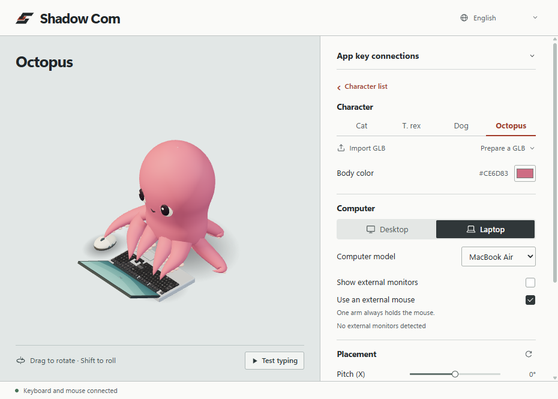

# Use your own GLB character

[한국어](custom-glb.ko.md) · **English** · [日本語](custom-glb.ja.md)　|　[Back to the user guide](../README.en.md)

Already have a model? Start with [Import into the widget](#import-into-the-widget). A static mesh works on its own. To make a hand reach a particular key or cover the character's eyes, include animation clips in the GLB.

## Export from Blender

1. Pose your character sitting at a keyboard. In the exported glTF, **+Y is up** and the character faces **+Z**. Blender's **+Y Up** export option handles the up-axis conversion.
2. Select the character's meshes and its armature, if it has one. Choose **File → Export → glTF 2.0**, set the format to **glTF Binary (.glb)** and enable **Selected Objects**. Distant scenery or props can make the character look tiny in the widget.
3. Use PNG or JPEG textures and embed all meshes, textures and buffers in the GLB. Turn off mesh compression. The limits per file are **128 MiB**, **2 million vertices** in total and **4,096 nodes**.
4. For an animated character, make each movement a separate Action with a name from the table below. Enable **Animation** and use **Actions** export mode. Import the resulting GLB into an empty Blender scene to check its textures and clip names. [Blender glTF exporter documentation](https://github.com/KhronosGroup/glTF-Blender-IO/blob/main/docs/blender_docs/scene_gltf2.rst)

## Import into the widget

1. Open **Widget settings → Placed characters** and click the name of the pet you want to change. Opening settings from a desktop pet can take you straight to its editor. Continue there, or click **Character list** to pick a different pet.
2. Click **Import GLB** and select the file. The widget scales and grounds the model, then keeps a copy in your app profile. Importing again replaces the model for that pet only.
3. Set **Body color** to white (`#ffffff`) to see the original material colors. Click **Test typing** to preview the movement. Adjust the angle and widget size under **Placement**.

## Animation clip names

| GLB clip name | When it plays and what to animate |
| --- | --- |
| `Idle` | Loops while the pet waits. A subtle breathing cycle works well. |
| `Typing` | The default keystroke. Animate one short press and release. |
| `Type_KeyA`, `Type_Digit7`, `Type_Backspace` | Overrides the default stroke for a physical key. Use its `KeyboardEvent.code` after `Type_` and pose the hand at that key. |
| `Pointer`, `Click` | Mouse movement and mouse button presses, respectively. |
| `TypingLeft`, `TypeLeft_KeyA` | The default and per-key left-hand strokes while the mouse is in use. Keyframe the left arm in the typing clip and the right arm in the mouse clip so they can play together. |
| `Pet` or `React` | Plays when someone clicks the pet on the desktop. |
| `CoverEyes` or `Privacy` | For a password field, hold a pose with the eyes closed and one hand covering them. Typing stops during this pose. |
| `Sleep`, `Wake` | Plays after inactivity and when activity resumes. Start the wake-up animation from the sleeping pose. |

## Troubleshooting

| What you see | What to check |
| --- | --- |
| The file won't open | Confirm it is a binary glTF 2.0 with at least one mesh of visible size. Embed any external images and export without formats that require extra decoders, such as Draco, Meshopt or KTX2. |
| The character is lying down or looks tiny | Check the exported forward and up axes. Exclude distant meshes from the export. The widget fits the entire model to its available space. |
| Only the whole body moves when typing | Reopen the exported GLB and check for `Typing` or a per-key clip. The top-row 7 uses `Digit7`, while the keypad 7 uses `Numpad7`. |
| The eyes and hand stay still in a password field | Animate the eyelids and arm in `CoverEyes`, then import the updated GLB. |
