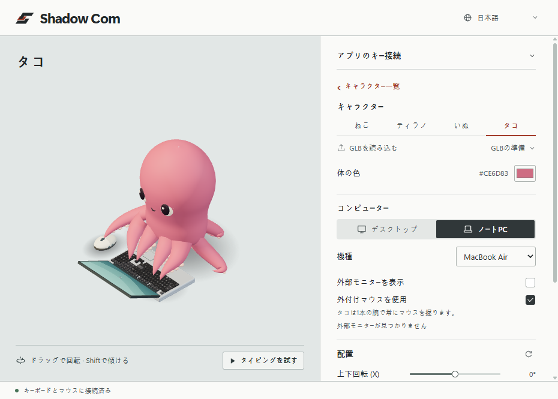

# 自作のGLBキャラクターを使う

[한국어](custom-glb.ko.md) · [English](custom-glb.en.md) · **日本語**　|　[使い方に戻る](../README.ja.md)

モデルをお持ちの方は[ウィジェットに読み込む](#ウィジェットに読み込む)から始めてください。メッシュだけのGLBも使えます。指を個々のキーまで動かしたり、目を閉じて手で覆ったりするには、その動きのアニメーションをGLBに含めます。

## Blenderから書き出す

1. キーボードの前に座った姿勢を基本ポーズにします。書き出したglTFの座標では、上が **+Y**、キャラクターの正面が **+Z** です。上方向の変換にはBlenderの書き出し設定 **+Y Up** を使えます。
2. キャラクターのメッシュと、使用するアーマチュアを選びます。**File → Export → glTF 2.0** で形式を **glTF Binary (.glb)** にして **Selected Objects** をオンにします。遠くの背景や小物が含まれていると、キャラクターが小さく表示されることがあります。
3. テクスチャにはPNGまたはJPEGを使い、メッシュ、テクスチャ、バッファーを1つのGLBにまとめます。メッシュ圧縮はオフにします。1ファイルの上限は **128 MiB**、頂点の合計は **200万個**、ノードは **4,096個** です。
4. アニメーションを付ける場合は、動作ごとに別のアクションを作り、下の表にある名前を付けます。書き出し時に **Animation** をオンにし、**Actions** モードを選びます。空のBlenderシーンに完成したGLBを読み込むと、テクスチャとクリップ名を確認できます。[Blender glTFエクスポーターのドキュメント](https://github.com/KhronosGroup/glTF-Blender-IO/blob/main/docs/blender_docs/scene_gltf2.rst)

## ウィジェットに読み込む

1. **ウィジェット設定 → 配置したキャラクター** で、変更したいペットの名前を押します。デスクトップのペットから設定を開くと、そのペットの編集画面が直接開くことがあります。そのまま次の手順に進むか、**キャラクター一覧** を押して別のペットを選びます。
2. **GLBを読み込む** を押し、ファイルを選びます。ウィジェットがモデルの大きさと接地位置を合わせ、アプリのプロファイルにコピーを保存します。同じペットにもう一度読み込むと、そのペットのモデルだけが入れ替わります。
3. 元の材質の色を確認するには、**体の色** を白（`#ffffff`）にします。**タイピングを試す** で動作を確認し、**配置** で角度とウィジェットの大きさを調整します。

## アニメーションクリップの名前

| GLBのクリップ名 | 再生される場面と作り方 |
| --- | --- |
| `Idle` | 入力を待つ間にループします。ゆっくり呼吸するような動きが使えます。 |
| `Typing` | 共通の打鍵動作です。キーを1回押して離す短い動きを作ります。 |
| `Type_KeyA`、`Type_Digit7`、`Type_Backspace` | その物理キーを押したときに優先されます。`Type_` の後に `KeyboardEvent.code` の名前を付け、手がキーに届く位置でポーズを作ります。 |
| `Pointer`、`Click` | それぞれマウスを動かすとき、マウスボタンを押すときの動作です。 |
| `TypingLeft`、`TypeLeft_KeyA` | マウス使用中に左手で打つ共通動作とキー別の動作です。左腕のボーンは打鍵クリップ、右腕のボーンはマウスのクリップに記録すると同時に再生できます。 |
| `Pet` または `React` | デスクトップのペットを直接クリックしたときに再生します。 |
| `CoverEyes` または `Privacy` | パスワード欄では目を閉じ、片手で覆った姿勢を保つように作ります。この間、打鍵は止まります。 |
| `Sleep`、`Wake` | 操作がしばらく途切れたときと、操作を再開したときの動作です。眠った姿勢から起き上がるように2つのクリップをつなげます。 |

## 思ったように表示されないとき

| 症状 | 確認すること |
| --- | --- |
| ファイルを開けない | バイナリ形式のglTF 2.0で、大きさのあるメッシュが含まれているか確認します。外部の画像は埋め込み、Draco、Meshopt、KTX2など追加のデコーダーが必要な形式を使わずに書き出します。 |
| 横倒しになる、または極端に小さい | 書き出したモデルの正面と上方向を確認し、遠くのメッシュを選択から外します。ウィジェットはモデル全体の範囲に合わせてサイズを決めます。 |
| 打鍵しても体全体が揺れるだけ | 書き出したGLBに `Typing` またはキー別のクリップがあるか確認します。上段の7は `Digit7`、テンキーの7は `Numpad7` です。 |
| パスワード欄で目や手が動かない | `CoverEyes` にまぶたと腕の動作を記録し、GLBをもう一度読み込みます。 |
