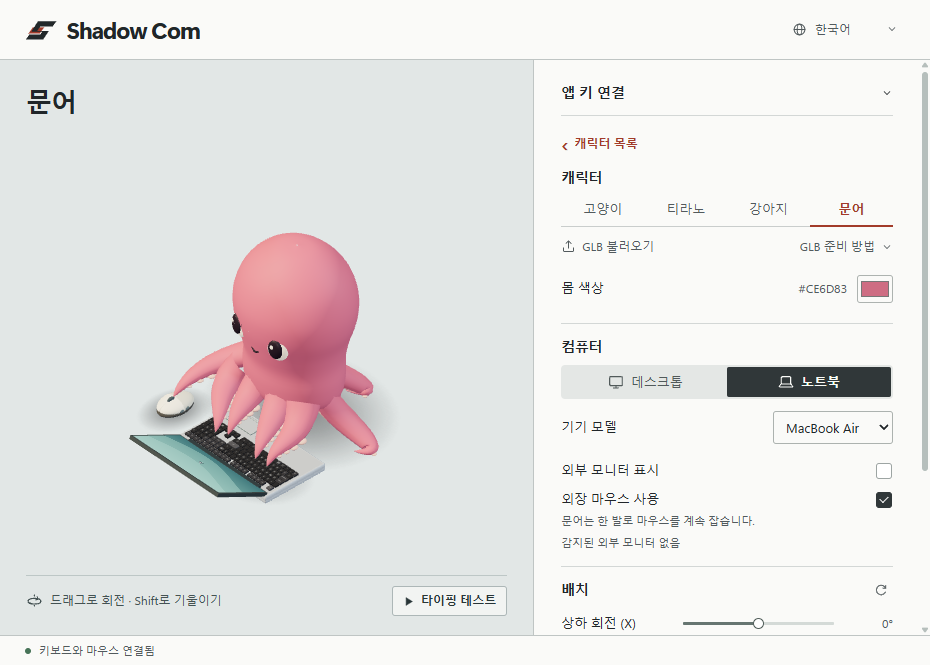

# 내 GLB 캐릭터 적용하기

**한국어** · [English](custom-glb.en.md) · [日本語](custom-glb.ja.md)　|　[사용법으로 돌아가기](../README.md)

이미 모델이 있다면 [위젯에 불러오기](#위젯에-불러오기)부터 시작하세요. 메시만 있는 GLB도 사용할 수 있습니다. 손가락을 키까지 움직이거나 눈을 감게 하려면 모델에 해당 애니메이션을 함께 넣으세요.

## Blender에서 내보내기

1. 캐릭터를 키보드 앞에 앉은 기본 자세로 놓으세요. 내보낸 glTF 좌표에서 위쪽은 **+Y**, 캐릭터가 바라보는 앞쪽은 **+Z**입니다. Blender에서는 내보내기의 **+Y Up** 옵션으로 위쪽 축을 변환할 수 있습니다.
2. 캐릭터 메시와 사용하는 아마추어를 선택하세요. **File → Export → glTF 2.0**에서 형식을 **glTF Binary (.glb)**로 선택하고 **Selected Objects**를 켜세요. 멀리 떨어진 배경·소품이 함께 들어가면 캐릭터가 작게 보일 수 있습니다.
3. 텍스처는 PNG 또는 JPEG를 사용하고 메시·텍스처·버퍼를 GLB 한 파일에 포함하세요. 메시 압축은 끄세요. 지원 한도는 파일당 **128 MiB**, 정점 합계 **200만 개**, 노드 **4,096개**입니다.
4. 애니메이션을 포함하려면 각 동작을 별도 Action으로 만들고 아래 표의 이름을 붙이세요. 내보내기에서 **Animation**을 켜고 **Actions** 모드로 내보내세요. 완성된 GLB를 빈 Blender 장면에 다시 가져오면 텍스처와 클립 이름을 확인할 수 있습니다. [Blender glTF 내보내기 문서](https://github.com/KhronosGroup/glTF-Blender-IO/blob/main/docs/blender_docs/scene_gltf2.rst)

## 위젯에 불러오기

1. **위젯 설정 → 배치한 캐릭터**에서 바꿀 캐릭터의 이름을 누르세요. 위젯에서 설정을 열어 이미 그 캐릭터의 편집 화면이 보이면 바로 다음 단계로 가세요. 다른 캐릭터를 고르려면 **캐릭터 목록**을 누르세요.
2. **GLB 불러오기**를 누르고 파일을 선택하세요. 위젯이 모델의 크기와 바닥 높이를 맞춥니다. 가져온 파일은 앱 프로필에 복사되며, 같은 캐릭터에 다시 불러오면 그 캐릭터의 모델만 교체됩니다.
3. **몸 색상**을 흰색(`#ffffff`)으로 두면 원래 재질 색상을 볼 수 있습니다. **타이핑 테스트**로 동작을 살펴보고, **배치**에서 위젯의 각도와 크기를 조절하세요.

## 동작을 연결하는 클립 이름

| GLB 클립 이름 | 재생 시점과 만드는 방법 |
| --- | --- |
| `Idle` | 입력을 기다릴 때 반복합니다. 호흡처럼 자연스럽게 이어지는 동작이 어울립니다. |
| `Typing` | 키를 누를 때 쓸 공통 동작입니다. 한 번의 짧은 타건으로 만드세요. |
| `Type_KeyA`, `Type_Digit7`, `Type_Backspace` | 해당 물리 키를 누르면 공통 동작보다 먼저 선택됩니다. `Type_` 뒤에 `KeyboardEvent.code` 이름을 붙이고, 손끝이 닿을 위치를 클립에서 잡으세요. |
| `Pointer`, `Click` | 각각 마우스를 움직일 때와 버튼을 누를 때의 동작입니다. |
| `TypingLeft`, `TypeLeft_KeyA` | 마우스를 쓰는 동안 왼손으로 하는 공통 타건과 키별 타건입니다. 동시에 재생하려면 왼팔 본은 타건 클립에, 오른팔 본은 마우스 클립에 넣으세요. |
| `Pet` 또는 `React` | 바탕화면에서 캐릭터를 직접 클릭할 때 재생합니다. |
| `CoverEyes` 또는 `Privacy` | 암호 입력란에서 눈을 감고 한 손으로 가린 자세를 유지하도록 만드세요. 이때 타건은 멈춥니다. |
| `Sleep`, `Wake` | 입력이 오래 없을 때와 다시 활동할 때 재생합니다. 잠든 자세에서 자연스럽게 일어나도록 두 클립을 이어 만드세요. |

## 원하는 모습이 나오지 않을 때

| 증상 | 확인할 점 |
| --- | --- |
| 파일을 열 수 없음 | 실제 바이너리 glTF 2.0인지, 크기가 있는 메시가 하나 이상인지 확인하세요. 외부 이미지 경로와 Draco·Meshopt·KTX2 같은 별도 디코더가 필요한 형식을 제거하고 다시 내보내세요. |
| 모델이 눕거나 너무 작음 | 내보낸 모델의 앞·위 방향을 확인하고, 멀리 있는 메시를 선택에서 빼세요. 위젯은 모델 전체의 경계에 맞춰 크기를 정합니다. |
| 타이핑할 때 몸만 움직임 | GLB를 다시 열어 `Typing`이나 키별 클립이 실제로 들어갔는지 확인하세요. 숫자열의 7은 `Digit7`, 숫자 키패드의 7은 `Numpad7`입니다. |
| 암호 입력 때 눈과 손이 움직이지 않음 | `CoverEyes` 클립에 눈꺼풀과 팔의 움직임을 기록하고 다시 불러오세요. |
